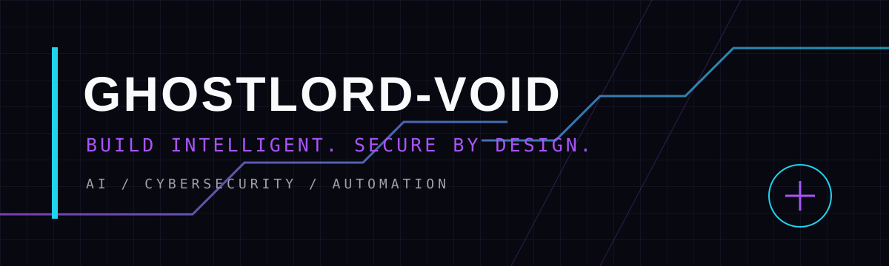

# GHOSTLORD-VOID

**BUILD INTELLIGENT. SECURE BY DESIGN.**

AI • CYBERSECURITY • AUTOMATION

Independent developer building practical AI tools, Python systems, and security-conscious automation.

[Projects](#selected-projects) · [Focus](#focus) · [Connect](#connect)

---

## Focus

- **AI development** — agent workflows, model integrations, and practical AI tooling
- **Cybersecurity** — defensive research, secure-by-default design, and responsible testing
- **Python & automation** — maintainable tools, APIs, and developer workflows
- **Open source** — documented projects, reproducible setup, and useful contributions

## Selected projects

| Project | What it is |
|---|---|
| [APEX Cyber Intelligence](https://github.com/GhostLORD-Void/apex-cyber-intelligence) | Security-focused tooling and MCP/CLI development |
| [REA Ω](https://github.com/GhostLORD-Void/rea-omega) | Python project with automated tests and security guidance |
| [UNIT-X2 Instagram MCP](https://github.com/GhostLORD-Void/unitx2-instagram-mcp.) | Read-only MCP scaffold using Meta's official Instagram Graph API |

## Principles

- Authorized, defensive, and responsible security work
- No secrets committed; configuration stays in environment variables
- Clear documentation and testable changes
- Prefer reliable engineering over hype

## Connect

- GitHub: [@GhostLORD-Void](https://github.com/GhostLORD-Void)

BUILD INTELLIGENT. SECURE BY DESIGN. · GHOSTLORD-VOID

