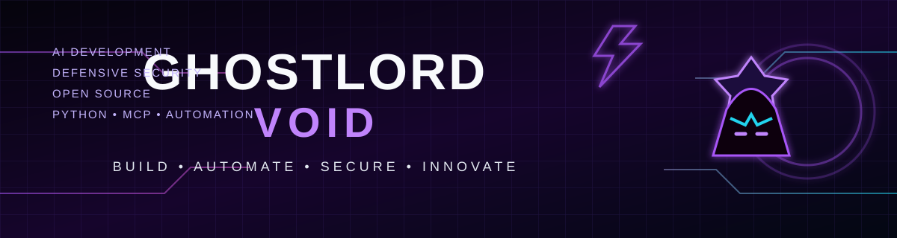

<div align="center">
  

  # GhostLORD-Void

  **Professional AI & Cybersecurity Developer Ecosystem**

  **BUILD INTELLIGENT. SECURE BY DESIGN.**

  *AI Development · Cybersecurity · Automation · Open Source*

  [Projects](#featured-projects) · [Technical focus](#technical-focus) · [Engineering principles](#engineering-principles) · [Contact](#contact)
</div>

---

## Ecosystem

GhostLORD-Void is an independent developer ecosystem for building practical AI-powered software, security-conscious developer tools, and responsible automation. It brings projects, experiments, documentation, and reusable engineering practices together under one identity.

The focus is on useful implementations, transparent limitations, maintainable code, and secure-by-default design—not unsupported claims.

## About

I build and experiment with developer tools, AI integrations, automation workflows, and defensive security projects. My work focuses on turning ideas into understandable, testable software with clear setup instructions and responsible defaults.

- **AI development:** model integrations, agent workflows, and MCP-based tooling
- **Cybersecurity:** defensive security concepts, secure configuration, and authorized testing
- **Automation:** practical workflows, APIs, and command-line tools
- **Engineering:** Python, JavaScript, documentation, version control, and automated checks

## Featured projects

| Project | Overview | Primary focus |
|---|---|---|
| [APEX Cyber Intelligence](https://github.com/GhostLORD-Void/apex-cyber-intelligence) | Security-oriented developer tooling and CLI/MCP experiments | Python · Security tooling |
| [UNIT-X2 Instagram MCP](https://github.com/GhostLORD-Void/unitx2-instagram-mcp.) | Read-only MCP scaffold designed around Meta's official Instagram Graph API | JavaScript · MCP · API integration |
| [REA Ω](https://github.com/GhostLORD-Void/rea-omega) | Python project with automated tests and security guidance | Python · Testing |

## Technical focus

```text
Languages       Python · JavaScript
AI & interfaces Model integrations · Agents · APIs · MCP
Tooling         CLI · Automation · Developer workflows
Practices       Git · Automated testing · Documentation
Priorities      Security · Reliability · Responsible automation
```

## Engineering principles

1. **Security by default** — keep credentials out of source code and use environment-based configuration.
2. **Authorized use only** — build for legitimate access, defensive work, and documented APIs.
3. **Testable changes** — prefer small, reviewable updates with meaningful checks.
4. **Clear documentation** — explain setup, limitations, and intended use.
5. **Evidence over hype** — describe what a project does, not what it cannot prove.

## Contact

- GitHub: [@GhostLORD-Void](https://github.com/GhostLORD-Void)
- Open an issue in the relevant repository for project questions or suggestions.

<div align="center">
  <sub>GHOSTLORD-VOID · PROFESSIONAL AI & CYBERSECURITY DEVELOPER ECOSYSTEM</sub>
</div>
